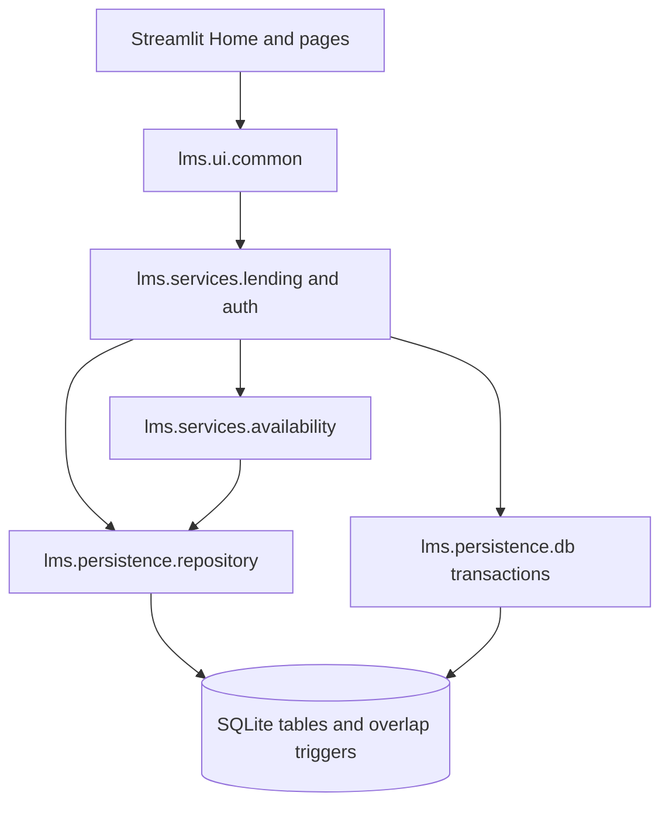
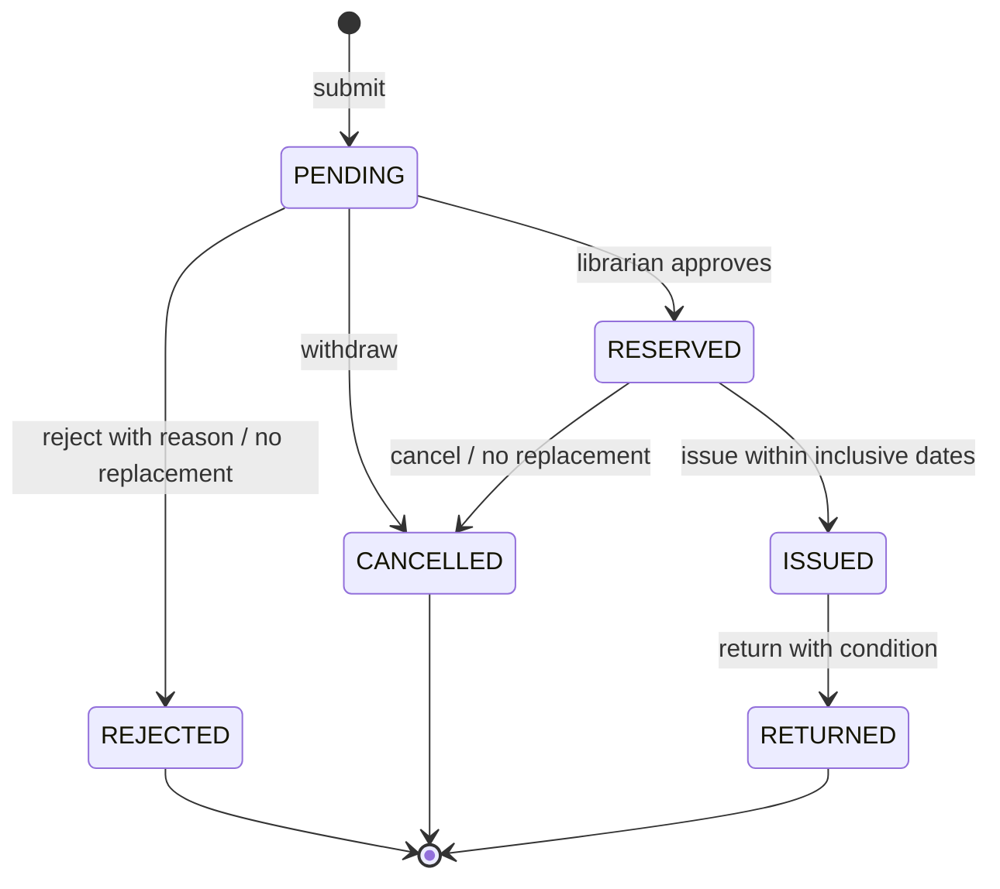
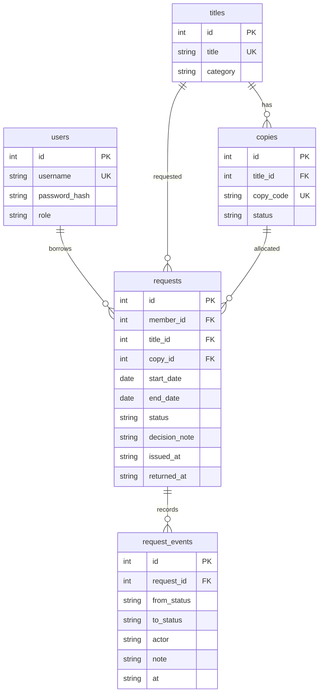

# Architecture

This document describes the agreed contracts. Service and persistence implementations are still pending; diagrams do not establish that runtime behavior passes validation.

## Layers

Pages also call service/read helpers directly. Shared dataclasses and enums live in `src/lms/domain/models.py`; errors in `errors.py`; the controllable business date in `clock.py`. Writes use a single `BEGIN IMMEDIATE` transaction, with rollback on exceptions. Tests use temporary databases, not the application database.

## Request state machine

PENDING, RESERVED, and ISSUED hold a copy. Moving a request to a replacement copy preserves its status and writes an audit event. Terminal states cannot reopen. Only IN_SERVICE copies can be allocated.

## Data relationships

Event actor is a username stored as text, not a user foreign key.

## Rule ownership

| Rule | Enforcement contract |
|---|---|
| BR1 | `services/lending.py: submit_request`; `persistence/schema.sql` required fields and foreign keys |
| BR2 | `services/availability.py: is_copy_free, free_copies, check_availability` |
| BR3 | Inclusive `overlaps`; transactional submission; schema insert/update overlap triggers |
| BR4 | `submit_request` rejects without inserting when no copy is free |
| BR5 | Availability checks copy status; lending inventory and return handlers manage affected commitments |
| BR6 | Submission creates PENDING; approval and issue enforce `domain/models.py` transitions |
| BR7 | Reject requires reason, releases commitment, and closes request; no edit API |
| BR8 | Cancellation allowed before issue; owning member or librarian only |
| BR9 | Return closes issued loan; condition can exclude copy and move/close future commitments |
| BR10 | Availability must cover entire interval on one copy; no partial allocation or alternative-title API |

Dates are inclusive and borrowing is limited to 30 inclusive days. Overdue issued loans use `max(end_date, business_today())` in availability. The SQL triggers check stored date ranges only, so overdue extension is enforced by the service, not independently by the triggers. `next_free_date` is a contract-defined hint based on blocking commitment end dates, not a guarantee that a complete future interval is free.
